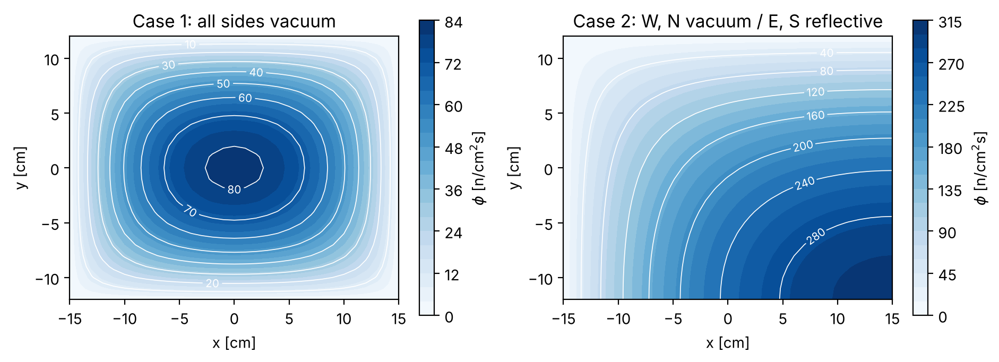
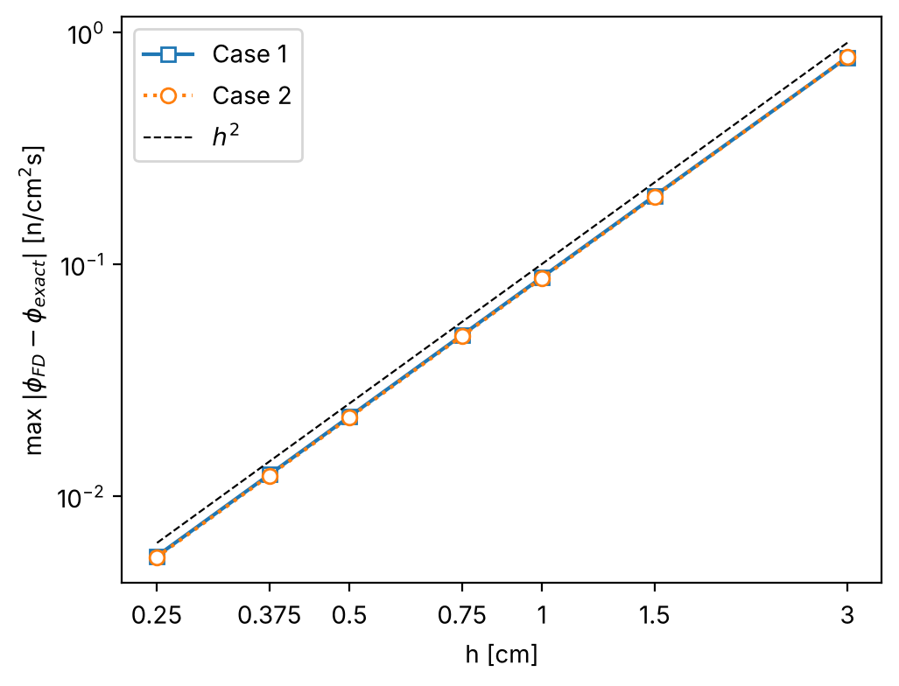

# 2-D One-Speed Neutron Diffusion by Finite Differences

Steady one-speed neutron diffusion in a 30 cm × 24 cm non-multiplying region with a uniform
source, solved with a five-point finite difference scheme for two sets of boundary conditions
and checked against a double Fourier series solution.

> NEM 493 Project I, Hacettepe University, Department of Nuclear Engineering.

## Problem

The region spans −15 ≤ x ≤ 15 cm and −12 ≤ y ≤ 12 cm and is homogeneous.

| Quantity | Value |
|:--|:--|
| Diffusion coefficient, D | 0.614014 cm |
| Absorption cross section, Σ<sub>a</sub> | 3.59817 × 10⁻⁴ cm⁻¹ |
| Source, S | 1 n/cm³s |
| Diffusion length, L = √(D/Σ<sub>a</sub>) | 41.31 cm |

| Case | West (x = −15 cm) | East (x = 15 cm) | South (y = −12 cm) | North (y = 12 cm) |
|:--|:--|:--|:--|:--|
| 1 | vacuum | vacuum | vacuum | vacuum |
| 2 | vacuum | reflective | reflective | vacuum |

## Method

| Item | Choice |
|:--|:--|
| Discretization | Five-point central differences, Δx = Δy = h; main results at h = 1 cm (31 × 25 nodes) |
| Vacuum sides | Zero flux on the physical boundary, as in the handout (extrapolation distance of 1.31 cm neglected) |
| Reflective sides | Ghost node mirrored across the boundary, which doubles the inner-neighbor coefficient |
| Linear solver | SciPy sparse direct solver; 667 unknowns in Case 1 and 720 in Case 2 at h = 1 cm |
| Reference | Double Fourier series for an all-vacuum box, summed to m, n = 4001 |
| Mesh study | Seven meshes from h = 3 cm to h = 0.25 cm |

Since a reflective side acts as a mirror, Case 2 is also one quarter of a 60 cm × 48 cm box
with vacuum on all sides, so the same series solution covers both cases. The ghost-node rows
make the Case 2 matrix non-symmetric. That is no problem for a direct solver; scaling those
rows by 1/2 (and the corner row by 1/4) would restore symmetry for an iterative one.

## Key Results (h = 1 cm)

| Quantity | Case 1 | Case 2 |
|:--|:--|:--|
| Peak flux, finite difference (n/cm²s) | 82.0118 at (0, 0) | 307.6488 at (15, −12) cm |
| Peak flux, series solution (n/cm²s) | 82.0995 | 307.7357 |
| Largest \|FD − exact\|, % of peak | 0.107 | 0.028 |
| Absorbed / leaked fraction of the source | 1.41% / 97.38% | 5.36% / 94.26% |
| Neutron balance gap | 1.21% | 0.38% |
| Observed order of accuracy, p | 1.98–2.00 | 2.00 |

<p align="center"></p>

Turning two vacuum sides into reflective ones raises the peak flux by a factor of 3.75. The
mirror picture accounts for most of it: doubling both sides of the region lowers the
fundamental-mode buckling from 0.02810 to 0.00703 cm⁻², and the one-mode estimate of the flux
ratio, 3.77, is within 0.5% of the finite difference result. The diffusion length (41.31 cm)
is longer than both sides of the region, so more than 94% of the source neutrons leak out in
both cases and the boundaries set the flux level far more than absorption does.

The finite difference flux is slightly below the series solution at every free node. The
error falls as h² in both cases, including at the reflective corner where both ghost nodes
enter the same equation. The balance gap comes mostly from the one-sided gradient used for the
leakage; at h = 0.5 cm it drops to 0.36% and 0.11%.

<p align="center"></p>

The main limitation is the vacuum boundary: the flux was set to zero on the physical boundary
and not at the extrapolated boundary 1.31 cm outside it, so the computed fluxes are lower than
a partial-current condition would give. Full derivations, both A matrices at h = 6 cm and the
discussion are in the [project report](docs/NEM493_Project1_Report.pdf).

## Running

```bash
pip install numpy scipy matplotlib
python nem493_p1.py      # matrices, fluxes, neutron balance, mesh refinement
python plot_figures.py   # writes the three figures to the current folder
```

## Repository Contents

| Path | Description |
|:--|:--|
| `nem493_p1.py` | Solver: matrix assembly, solution, series solution, balance and mesh study (code listed in the report appendix) |
| `plot_figures.py` | Standalone script that reproduces the report figures |
| `figures/` | Flux maps, center-line profiles and convergence plot |
| `docs/NEM493_Project1_Report.pdf` | Project report |

## Author

**Emre Sakarya**, Nuclear Engineering, Hacettepe University (Student ID: 2230386062).
